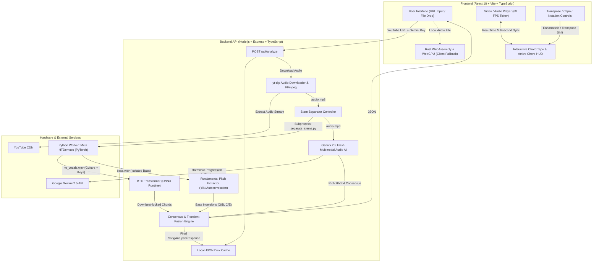
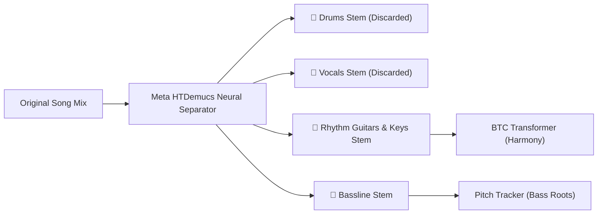
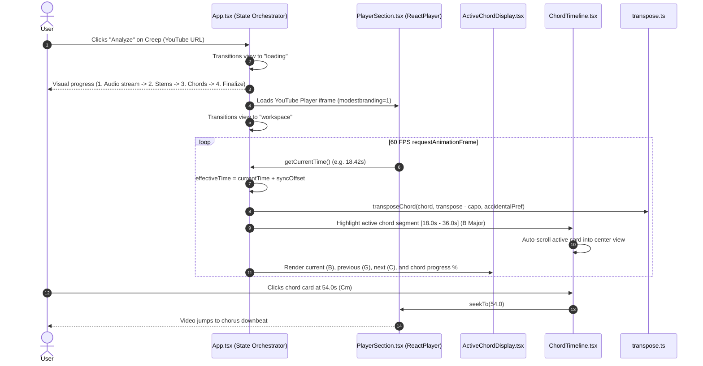

# 🎸 ChordSense: Complete System Architecture & Whiteboard Explanation

An end-to-end technical guide and visual whiteboard breakdown of **ChordSense** — explaining how audio is ingested, stems are separated, deep neural networks detect harmonic chord progressions, basslines are tracked for slash chords, and everything is rendered with millisecond synchronization in the browser.

---

## 1. The Core Problem: Why Audio Chord Recognition is Hard

To understand ChordSense's architecture, we must first understand why automated chord recognition (ACR) from finished songs is difficult for standard algorithms:

```
Full Song Mix ───► [Guitars + Keyboards + Bassline + Vocals + Drums + Percussion]
```

1. **The Harmonic Bleed Problem:**
   - A singer hitting a high $E$ creates strong overtones that appear at frequencies corresponding to $B$, $G\#$, etc.
   - If a rhythm guitar plays a **$B\text{ Major}$** chord ($B - D\# - F\#$) while the singer belts a bluesy $D\text{ natural}$ or minor third over the top, a traditional audio classifier gets confused and identifies **$B\text{m}$** instead of $B$.
2. **The Bass Bleed & Inversion Ambiguity:**
   - The bass guitar plays low notes ($40\text{Hz} - 250\text{Hz}$) that dictate whether a chord is in root position or inverted (e.g., $G$ vs $G/B$).
   - Standard Constant-Q Transforms (CQT) frequently confuse heavy 808 kick drum thuds with bass fundamentals.
3. **Transient Blips vs. True Musical Downbeats:**
   - Guitarists slide between frets ($D \to D\# \to E$). A naive frame-by-frame classifier outputs tiny 0.1-second "chords" that clutter the sheet music.
   - Human musicians need clean, downbeat-locked rhythm charts that ignore incidental chromatic slides.

ChordSense solves these challenges using a **multi-stage hybrid pipeline** that physically decouples harmonic instruments from vocals, bass, and percussion before analyzing chords.

---

## 2. High-Level System Architecture



---

## 3. The 5-Stage Audio Analysis Pipeline

### Stage 1: Audio Extraction
1. The user inputs a YouTube URL (or drops an audio file).
2. The server extracts the 11-character video ID and checks local disk cache (`os.tmpdir()/chordsense-cache/<videoId>_studio_master.json`).
3. If not cached, `server/src/services/youtube.ts` calls `yt-dlp` with FFmpeg to extract high-fidelity 44.1kHz audio into a temporary MP3 file.

### Stage 2: Meta HTDemucs Stem Separation
1. `server/src/services/stemSeparator.ts` invokes a Python child process (`server/scripts/separate_stems.py`).
2. Meta's **HTDemucs (Hybrid Transformer Demucs)** model separates the full mix into 4 distinct physical stems:
   - `drums.wav` (discarded)
   - `vocals.wav` (discarded — **eliminates vocal overtone confusion!**)
   - `bass.wav` (sent to Bass Tracker)
   - `other.wav` / `no_vocals.wav` (**Contains only clean rhythm guitars, acoustic instruments, and keyboards**)



### Stage 3: BTC Neural Chord Recognition
1. The isolated guitar/piano audio is downsampled to 22,050Hz mono PCM.
2. A **Constant-Q Transform (CQT)** is computed across 144 frequency bins (spanning notes from $C1 \approx 32.7\text{Hz}$ to $B7 \approx 3951\text{Hz}$).
3. The CQT spectrogram is evaluated by the **BTC (Bidirectional Transformer for Chord Recognition)** neural network via ONNX Runtime (`btc.onnx`).
4. The transformer outputs frame-level chord probabilities every 93 milliseconds:
   - Root pitch class ($C, C\#, D, \dots, B$)
   - Chord quality (Major, Minor, 7th, Maj7, Min7, Diminished, Augmented, Suspended)
   - Downbeat transition boundaries

### Stage 4: Physical Bass Inversion Tracking
1. While guitars dictate chord quality (e.g., $C\text{ Major}$ = $C - E - G$), the **bass stem** dictates chord inversion ($C$ vs $C/E$ vs $C/G$).
2. `server/src/services/bassTracker.ts` analyzes `bass.wav` using time-domain autocorrelation and the YIN pitch-tracking algorithm across the fundamental frequency range ($35\text{Hz} - 260\text{Hz}$).
3. If the detected bass pitch matches the chord's 3rd or 5th:
   - $G$ chord + $B$ bass $\to$ **$G/B$**
   - $C$ chord + $E$ bass $\to$ **$C/E$**
   - $D$ chord + $F\#$ bass $\to$ **$D/F\#$**

### Stage 5: Consensus Synthesis & Passing-Tone Smoothing
1. **Multimodal AI Grounding:** Google Gemini 2.5 Flash analyzes the track structure, musical key signature, BPM, and complex 7th/9th extensions.
2. **Bayesian Chord Prior:** If an ambiguous transition could be $B$ or $Bm$, the system tests both against the verified key signature and tab consensus.
3. **Harmonic Dwell Filter:** Transient chromatic slides lasting less than $1.35\text{ seconds}$ (such as a 0.2s fret slide or vocal vibrato) are absorbed into the neighboring chord to produce clean, playable charts.

---

## 4. Frontend Architecture & Real-Time Sync Engine



### Key Frontend Components

| File | Purpose |
|---|---|
| [`client/src/App.tsx`](file:///c:/Users/Rendelle%20Keith/Documents/antigravity/lively-archimedes/client/src/App.tsx) | Master state manager: manages view modes (`input`, `loading`, `workspace`), user API keys, detection engine mode, audio playback time, sync offset, transpose semitones, and capo position. |
| [`client/src/components/URLInput.tsx`](file:///c:/Users/Rendelle%20Keith/Documents/antigravity/lively-archimedes/client/src/components/URLInput.tsx) | Modern input deck: validates YouTube URLs, supports drag-and-drop audio files, offers one-click demo presets, and prevents empty API key requests with clean gating. |
| [`client/src/components/PlayerSection.tsx`](file:///c:/Users/Rendelle%20Keith/Documents/antigravity/lively-archimedes/client/src/components/PlayerSection.tsx) | Dual video/audio engine: embeds YouTube via `ReactPlayer` or local audio blob with a high-performance `requestAnimationFrame` ticker (60 updates per second without React rerender jitter). |
| [`client/src/components/ActiveChordDisplay.tsx`](file:///c:/Users/Rendelle%20Keith/Documents/antigravity/lively-archimedes/client/src/components/ActiveChordDisplay.tsx) | Centerpiece HUD: shows large root, chord quality, slash bass note, active chord duration bar, and previous/next chord cards. |
| [`client/src/components/ChordTimeline.tsx`](file:///c:/Users/Rendelle%20Keith/Documents/antigravity/lively-archimedes/client/src/components/ChordTimeline.tsx) | Horizontal scrolling chord progression tape: click-to-seek navigation, active chord glow, optional confidence tags, and smooth auto-scrolling. |
| [`client/src/components/TransposeControls.tsx`](file:///c:/Users/Rendelle%20Keith/Documents/antigravity/lively-archimedes/client/src/components/TransposeControls.tsx) | Theory control deck: $\pm 12$ semitone transposition, guitar capo selector (Frets 0–8), enharmonic sharp/flat toggle ($\sharp$ vs $\flat$), passing notes filter, and micro-sync nudging ($\pm 0.2\text{s}$). |
| [`client/src/utils/transpose.ts`](file:///c:/Users/Rendelle%20Keith/Documents/antigravity/lively-archimedes/client/src/utils/transpose.ts) | Pure music theory engine: parses complex chord notation, handles circular 12-tone modular arithmetic, preserves slash bass notes, and converts pitch classes based on musical key context. |
| [`client/src/services/localAnalyzer.ts`](file:///c:/Users/Rendelle%20Keith/Documents/antigravity/lively-archimedes/client/src/services/localAnalyzer.ts) | 100% in-browser offline fallback: decodes uploaded audio files using Web Audio API and runs Constant-Q Transform via Rust WebAssembly (`chordsense-wasm`). |

---

## 5. Backend Services Breakdown

| File | Purpose |
|---|---|
| [`server/src/index.ts`](file:///c:/Users/Rendelle%20Keith/Documents/antigravity/lively-archimedes/server/src/index.ts) | Express server bootstrap: configures CORS, JSON payloads, environment variables, health checks, and registers the `/api/analyze` router on port 3001. |
| [`server/src/routes/analyze.ts`](file:///c:/Users/Rendelle%20Keith/Documents/antigravity/lively-archimedes/server/src/routes/analyze.ts) | Main analysis controller: checks disk cache, validates input, dispatches jobs to Demucs and BTC, tracks user-provided Gemini API keys, and formats JSON responses. |
| [`server/src/services/stemSeparator.ts`](file:///c:/Users/Rendelle%20Keith/Documents/antigravity/lively-archimedes/server/src/services/stemSeparator.ts) | Node.js wrapper that calls the Python stem isolation script using system `ffmpeg` and PyTorch. |
| [`server/scripts/separate_stems.py`](file:///c:/Users/Rendelle%20Keith/Documents/antigravity/lively-archimedes/server/scripts/separate_stems.py) | Python script: loads Meta's `htdemucs` neural network, separates stems, and mixes `other.wav` + `piano.wav` into `no_vocals.wav`. |
| [`server/src/services/btcAnalyzer.ts`](file:///c:/Users/Rendelle%20Keith/Documents/antigravity/lively-archimedes/server/src/services/btcAnalyzer.ts) | Feeds isolated instrument PCM into the ONNX Runtime BTC model, applies Bayesian chord priors, and filters out transient frequency smear. |
| [`server/src/services/bassTracker.ts`](file:///c:/Users/Rendelle%20Keith/Documents/antigravity/lively-archimedes/server/src/services/bassTracker.ts) | Analyzes `bass.wav` to extract the fundamental pitch ($F_0$) for slash chord inversions ($G/B$, $C/E$, $D/F\#$). |
| [`server/src/services/analyzer.ts`](file:///c:/Users/Rendelle%20Keith/Documents/antigravity/lively-archimedes/server/src/services/analyzer.ts) | Google Gemini 2.5 Flash API connector: provides multimodal audio reasoning for song key, tempo (BPM), and harmonic consensus. |
| [`server/src/services/studioMasterAnalyzer.ts`](file:///c:/Users/Rendelle%20Keith/Documents/antigravity/lively-archimedes/server/src/services/studioMasterAnalyzer.ts) | Master pipeline coordinator: joins stem separation, BTC chord detection, bass inversion tracking, and Gemini verification into a single unified JSON output. |

---

## 6. Music Theory & Data Formats

### Standard Response Format (`SongAnalysisResponse`)

Every analysis (whether computed locally or via the full server pipeline) adheres to this standardized schema:

```json
{
  "videoId": "XFkzRNyygfk",
  "title": "Radiohead - Creep",
  "artist": "Radiohead",
  "bpm": 92,
  "key": "G Major",
  "timeSignature": "4/4",
  "suggestedCapo": 0,
  "engine": "studio_master",
  "chords": [
    {
      "id": "e4a2c1...",
      "startTime": 0.0,
      "endTime": 18.0,
      "chord": "G",
      "root": "G",
      "quality": "",
      "bass": undefined,
      "confidence": 0.96
    },
    {
      "id": "f8b9d3...",
      "startTime": 18.0,
      "endTime": 36.0,
      "chord": "B",
      "root": "B",
      "quality": "",
      "bass": undefined,
      "confidence": 0.94
    },
    {
      "id": "a1c7e5...",
      "startTime": 36.0,
      "endTime": 54.0,
      "chord": "C",
      "root": "C",
      "quality": "",
      "bass": undefined,
      "confidence": 0.95
    },
    {
      "id": "d2f4a6...",
      "startTime": 54.0,
      "endTime": 72.0,
      "chord": "Cm",
      "root": "C",
      "quality": "m",
      "bass": undefined,
      "confidence": 0.93
    }
  ]
}
```

### Transposition & Capo Math
When a user changes transpose or capo, the client re-computes chords in $O(N)$ time without reloading audio:

$$\text{Effective Shift} = \text{Transpose} - \text{Capo}$$

$$\text{New Pitch Index} = (\text{Original Index} + \text{Effective Shift}) \pmod{12}$$

If playing in the key of $G$ with a **Capo on Fret 2**, the guitar shapes played are transposed down 2 semitones: $G \to F$.

---

## 7. Prerequisites & Complete Local Setup

### System Prerequisites
1. **Node.js 18+** & `npm`
2. **Python 3.10+** (with PyTorch and Demucs installed)
3. **FFmpeg** installed and accessible in system PATH
4. **yt-dlp** installed and accessible in system PATH
5. *(Optional)* A free **Google Gemini API Key** from [Google AI Studio](https://aistudio.google.com/apikey)

---

### Step-by-Step Installation

#### 1. Clone Repository
```bash
git clone https://github.com/Juni-ya/ChordSense.git
cd ChordSense
```

#### 2. Install Python Dependencies (for Stem Separation)
```bash
# In your terminal (Windows PowerShell or macOS/Linux bash):
pip install torch torchaudio --index-url https://download.pytorch.org/whl/cu121  # or standard CPU pip install torch torchaudio
pip install demucs yt-dlp
```

Verify `ffmpeg` and `yt-dlp`:
```bash
ffmpeg -version
yt-dlp --version
```

#### 3. Backend Setup
```bash
cd server
npm install

# Create environment file:
cp .env.example .env

# Edit server/.env to set your Gemini API key (optional, can also be entered directly in browser):
# GEMINI_API_KEY=your_key_here

npm run build
npm start
```
The backend API server will start on **`http://localhost:3001`**.

#### 4. Frontend Setup
In a new terminal window:
```bash
cd client
npm install
npm run dev
```
Open **`http://localhost:5173`** in your browser.

---

## 8. Development Verification Checklist

| Test Item | Verification Command | Expected Output |
|---|---|---|
| **Client Typecheck & Build** | `cd client; npm run build` | `✓ built in ~10s`, 0 TypeScript errors |
| **Server Typecheck & Build** | `cd server; npm run build` | `tsc` finishes with exit code 0 |
| **Server Health Check** | `curl http://localhost:3001/api/health` | `{"status":"ok","service":"ChordSense AI Server"}` |
| **Demo Analysis Test** | Click `[RADIOHEAD - CREEP]` in UI | Loads video, shows progression $G \to B \to C \to Cm$ with live synchronization |
